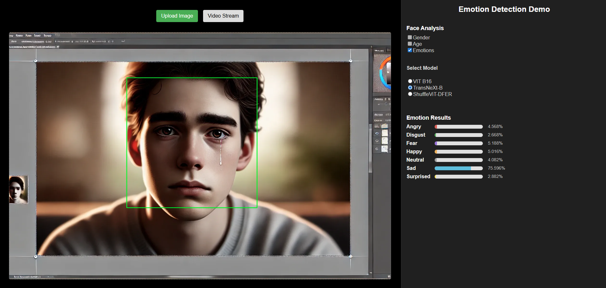
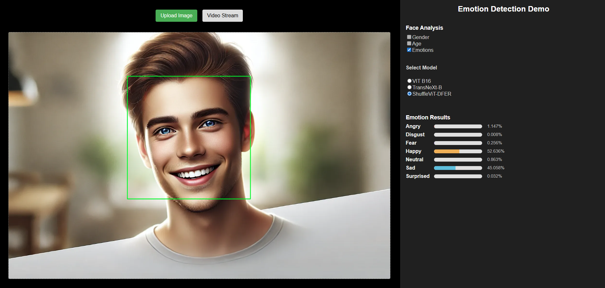
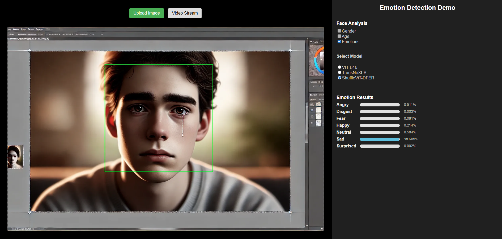
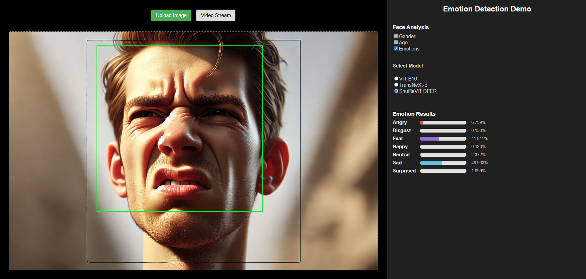

# Emotion Recognition with Vision Transformers and Hybrid Models

## Project Overview

This repository contains:

- **Fine-tuning scripts** for training and experimenting with facial emotion recognition models including ViT, TransNeXt, ShuffleViT-DFER.  
- **Application code** for serving models via a FastAPI backend and providing a React-based frontend UI for real-time emotion detection demos.

Models covered include:

- Vanilla Vision Transformer (ViT-B/16)
- TransNeXt-B  
- ShuffleViT-DFER (hybrid CNN + ViT architecture)

---

## Setup and Installation

### Backend (FastAPI Service)

1. Create and activate a Python virtual environment:

```bash
python -m venv .venv
source .venv/bin/activate    # Linux/macOS
.\.venv\Scriptsctivate     # Windows PowerShell
```

2. Install dependencies:

```bash
pip install -r Application/emotion-services/requirements.txt
```

3. Place pretrained model checkpoints in:

```
Application/emotion-services/app/models/
```

with filenames matching model loader keys (e.g., `vit_b16.pth`, `transnext_b.pth`, `shufflevit.pth`).

4. Run the FastAPI backend:

```bash
cd Application/emotion-services
uvicorn app.main:app --reload --host 0.0.0.0 --port 8000
```

### Frontend (React UI)

1. Ensure Node.js (≥18 LTS) and pnpm (or npm) are installed.

2. Install frontend dependencies:

```bash
cd Application/emotion-detection-ui
pnpm install
```

3. Configure the backend URL in `.env.local`:

```
VITE_API_URL=http://localhost:8000
```

4. Start the frontend development server:

```bash
pnpm dev
```

5. Open your browser at the printed local URL (commonly `http://localhost:5173`).

---

## Usage

- Use the frontend to upload images or stream webcam video for emotion recognition.  
- Switch between available models dynamically.  
- Backend API accepts image uploads at `/upload` and returns emotion predictions.

---

## results Comparison: TransNeXt-B vs. ShuffleViT-DFER

### 📁 Place result images here

```text
results/
├── transnext_1.png
├── transnext_2.png
├── transnext_3.png
├── shufflevit_1.png
├── shufflevit_2.png
└── shufflevit_3.png
```

### TransNeXt-B Emotion Detection

|  |  |  |
|------------------------------|------------------------------|------------------------------|
| *Example 1 — Complex emotion (e.g. anger + fear)* | *Example 2 — Misleading neutral expression* | *Example 3 — Accurate detection of sadness* |

---

### ShuffleViT-DFER Emotion Detection

|  |  |  |
|-------------------------------|-------------------------------|-------------------------------|
| *Example 1 — Improved localization via CNN+attention* | *Example 2 — Accurate multi-label blend (sad + surprise)* | *Example 3 — Handles real-world variance (pose/light)* |

---

## Notes

- Fine-tuning scripts and datasets live alongside application code in this repo.  
- Backend imports external model repos (TransNeXt, ShuffleViT-DFER) with Python path adjustments.  
- Only load checkpoints from trusted sources due to PyTorch unpickling security.  

---

## Team & Contact

For questions or support, contact:

- Nguyễn Duy Anh - 24C15002 - <24C15002@student.hcmus.edu.vn>
- Nguyễn Phạm Khôi Nguyên - 24C15013 - <24C15013@student.hcmus.edu.vn>
- Nguyễn Trọng Phúc - 24C15019 - <24C15019@student.hcmus.edu.vn>

---

## License

Specify license here (e.g., MIT, Apache 2.0)
